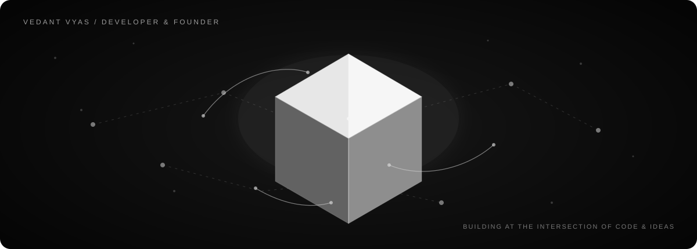
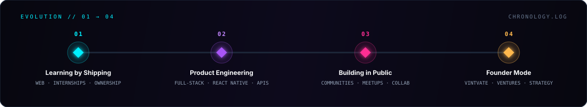
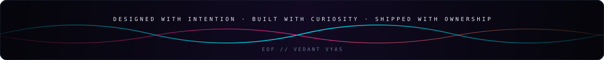

<!--
  VEDANT VYAS · Retro-Futuristic 3D Animated GitHub Profile README
  100% GitHub-native: all motion graphics run inside animated SVG assets.
-->

  

 

  
  
  

  
  
  

---

## `// 01` · About

I'm a developer who likes moving beyond the screen where an idea starts. I work across **frontend, backend, mobile, integrations, and product thinking**—bringing those pieces together into software people can actually use.

I care about the details: **interaction design, motion, performance, clean architecture**, and the small decisions that make a digital product feel intentional. Alongside engineering, I'm building ventures and bringing builders together around technology.

---

## `// 02` · Evolution in Chapters

  

<table>
<tr>
<td width="50%" valign="top">
<h3><code>01</code> — Learning by shipping</h3>

Started with the web, kept building, and moved from experiments and internships into real product work—learning by shipping, debugging, collaborating, and taking ownership.

</td>
<td width="50%" valign="top">
<h3><code>02</code> — Product engineering</h3>

Expanded into full-stack development, React Native, backend services, payments, authentication, and the architecture behind product experiences.

</td>
</tr>
<tr>
<td width="50%" valign="top">
<h3><code>03</code> — Building in public</h3>

Started building communities and side projects, turning technical interests into products, meetups, partnerships, and experiments.

</td>
<td width="50%" valign="top">
<h3><code>04</code> — Founder mode</h3>

Building <strong>Vintvate</strong> while continuing to work on products, explore ideas, collaborate with builders, and get closer to the business side of software.

</td>
</tr>
</table>

---

## `// 03` · Where I've Worked

| Team | Role | Focus |
|---|---|---|
| **Cikka** | `Software Developer · Current` | Product development with React Native and modern app engineering |
| **Devnovate** | `Frontend Developer` | Frontend architecture and interactive web experiences |
| **Creomind Innovations** | `Full-stack Intern` | End-to-end full-stack product development |
| **Shadow Fox** | `Web Development Intern` | Web development and hands-on shipping |

---

## `// 04` · Things I'm Building

  

 

| Venture | Domain | Overview |
|---|---|---|
| [**Vintvate ↗**](https://vintvate.tech) | `Digital Studio` | Premium websites, digital products, custom software, mobile apps, SaaS, and AI-powered workflows. |
| [**Stackhouse ↗**](https://stackhouse.social/) | `Builder Community` | Community for developers, founders, and Web3 builders—meetups, collaborations, and builder rooms. |
| [**MEOW ↗**](https://meow-lac-chi.vercel.app/) | `Events & RSVP` | Product experiment around event discovery, RSVP flows, organizer profiles, and modern hosting. |
| [**Pixel Pilgrim ↗**](https://www.pixelpilgrim.tech/) | `Gaming Social` | Social space for gamers to log games, share opinions, and discover what others are playing. |
| [**AutoBrief AI ↗**](https://daily-team-whisper.onrender.com/) | `Team Intelligence` | AI workspace turning GitHub, Slack, Jira, calendars, and Notion context into standup summaries and insights. |

---

## `// 05` · Current Focus

- Shipping product features at **Cikka**
- Growing **Vintvate** into a product-minded digital studio
- Scaling **Stackhouse** as a community and builder ecosystem
- Refining event-tech and community workflows through **MEOW**
- Deepening **system design, backend engineering, mobile performance, and product execution**

---

## `// 06` · Tech Stack

  

<strong>Expand full toolkit</strong>

- **Frontend:** React, Next.js, React Native, JavaScript, TypeScript, Tailwind CSS
- **Backend:** Node.js, Express, REST APIs, MongoDB, PostgreSQL
- **Platform & Services:** Supabase, Firebase, authentication, email, payments, third-party APIs
- **Motion & Experience:** GSAP, Framer Motion, Lenis
- **Workflow:** Git, GitHub, Figma, Android Studio

---

## `// 07` · Principles

  <table>
    <tr>
      <td align="center" width="33%"><strong>Make it useful.</strong> Purpose before polish.</td>
      <td align="center" width="33%"><strong>Make it feel right.</strong> Details are part of the product.</td>
      <td align="center" width="33%"><strong>Keep learning.</strong> Ship, reflect, iterate.</td>
    </tr>
  </table>

---

## `// 08` · Connect

I'm always up for collaborating on interesting products, creative engineering, community projects, or ideas that deserve to be built.

  <a href="https://vedantsrealm.vercel.app/">Portfolio</a> ·
  <a href="https://vintvate.tech">Vintvate</a> ·
  <a href="https://stackhouse.social/">Stackhouse</a> ·
  <a href="https://www.pixelpilgrim.tech/">Pixel Pilgrim</a>

 

  

